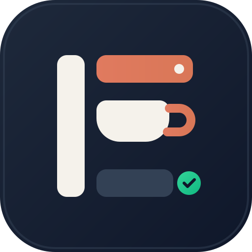
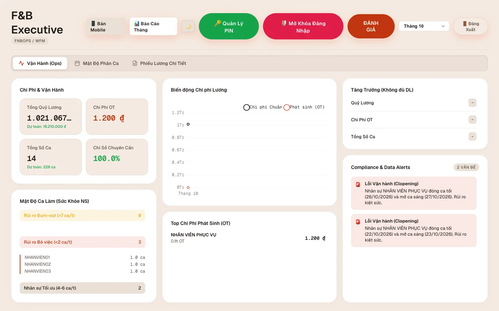
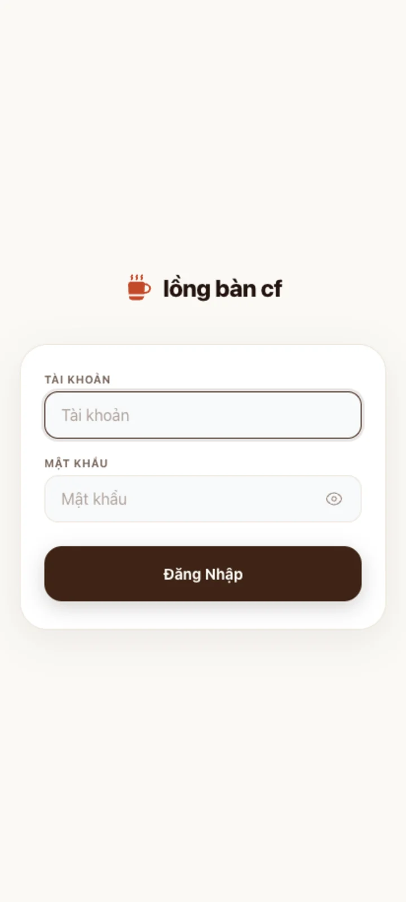
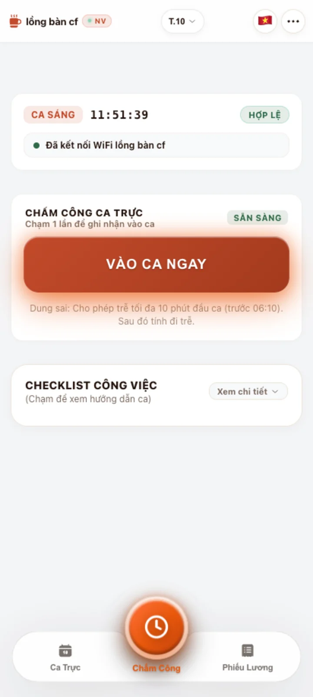
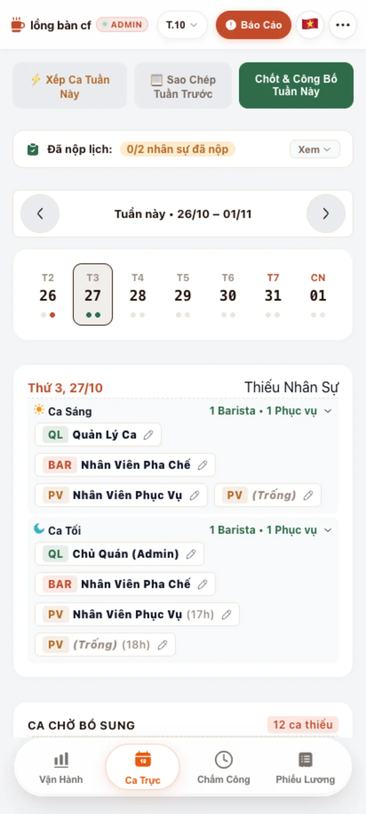
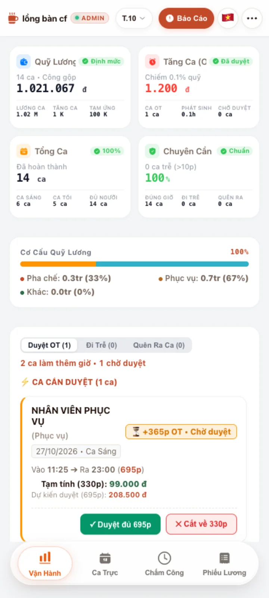
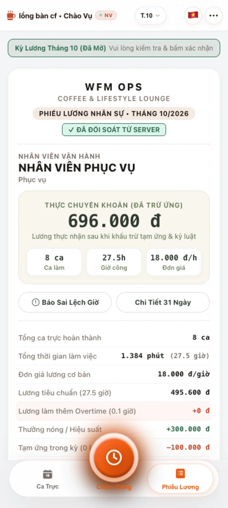
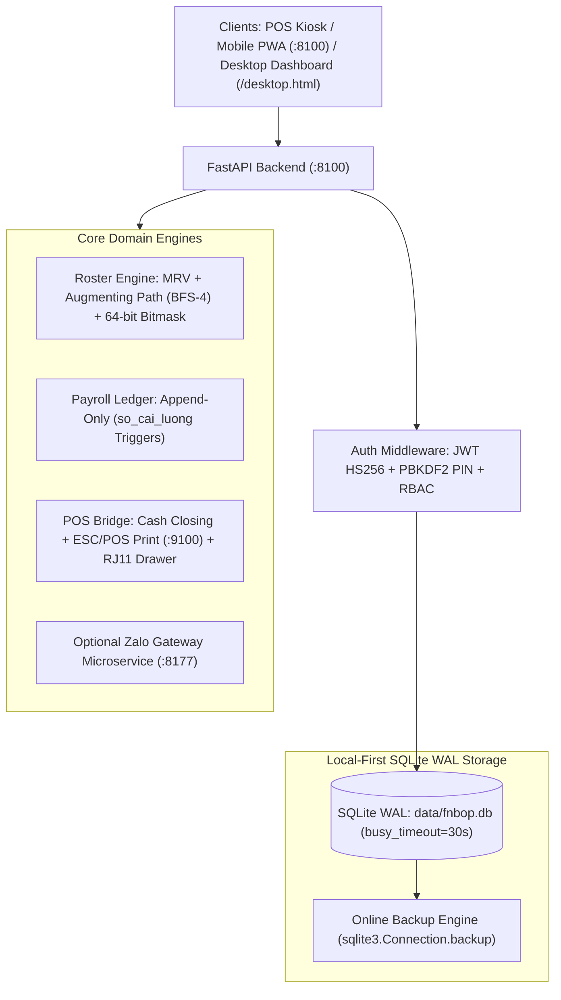

<p align="center">
  
</p>

<h1 align="center">FnBOps</h1>

<p align="center">
  <strong>Open-Source Workforce Management, 1-Touch Attendance, Shift Scheduling & Immutable Payroll OS</strong><br>
  <em>Designed for F&B (Cafes, Restaurants, Bars) and Small-to-Medium Enterprises (SMEs)</em>
</p>

<p align="center">
  <a href="https://github.com/nguyendaihoanh/fnbop/actions/workflows/ci.yml"></a>
  <a href="LICENSE"></a>
  <a href="https://python.org"></a>
  <a href="https://fastapi.tiangolo.com"></a>
  <a href="docs/ARCHITECTURE.md"></a>
  <a href="tests/"></a>
</p>

> **Languages:** [English](#english) | [Tiếng Việt](#tiếng-việt)

---

<a name="english"></a>
## English

### 1. Overview

**`fnbop` (FnBOps)** is an open-source workforce management (WFM), shift scheduling, POS cash drawer reconciliation, and automated payroll system built for Food & Beverage and retail stores (coffee shops, restaurants, bars, boba shops, bakeries).

Designed with an **Edge-First, Local-First Architecture**:
- **Standalone On-Premise (`v1.0`):** Runs natively on store POS terminals (Windows, macOS, Linux) with 100% offline capability using high-concurrency SQLite WAL (`data/fnbop.db`) and offline-cached PWA assets.
- **Multi-Tenant SaaS Ready (`v2.0 Roadmap`):** Supports physical database-per-tenant isolation (`data/tenants/{tenant_id}.db`) with a central control database (`control.db`) and LRU connection pooling.

#### Core Capabilities
- **WiFi Geofenced 1-Touch Attendance:** Verifies store WiFi WAN IP / Access Point BSSID and prevents remote punch spoofing.
- **Automated Shift Roster Engine:** Assigns weekly shifts using Minimum Remaining Values (MRV), Kuhn's Augmenting Path (BFS depth 4), and 64-bit bitmask conflict checks (anti-clopening, skill coverage, fair-share quotas).
- **Append-Only Payroll Ledger:** Integer VND accounting backed by SQLite triggers that block `UPDATE` and `DELETE` on `so_cai_luong`, using `REVERSAL` entries for auditability.
- **POS Cash Closing & Hardware Integration:** Multi-shift cash drawer reconciliation, raw socket ESC/POS thermal receipt printing (TCP port `9100` / USB), and RJ11 cash drawer kick pulses.

<p align="center">
  
</p>
<p align="center">
  
  
  
  
  
</p>

---

### 2. System Architecture



---

### 3. Quickstart

#### Option A: 1-Click Native Launcher (Windows POS & macOS)
- **Windows:** Double-click [`run_windows.bat`](run_windows.bat) — automatically configures `.env` with a random 256-bit `JWT_SECRET_KEY`, checks/installs dependencies in `.venv` or portable `python_runtime/`, starts the server on `http://localhost:8100`, and opens the browser.
- **macOS:** Double-click [`run_mac.command`](run_mac.command).
- **Mobile PWA:** Connect phone to store WiFi, open `http://<pos_lan_ip>:8100`, and tap **Add to Home Screen**.

#### Option B: Standard Python / Uvicorn
```bash
python3 -m venv .venv
source .venv/bin/activate
pip install -r requirements.txt
python -m uvicorn backend.main:app --host 0.0.0.0 --port 8100
```
- **Mobile / Storefront UI:** `http://localhost:8100/`
- **Desktop Executive Dashboard:** `http://localhost:8100/desktop.html`
- **Health Check:** `http://localhost:8100/health`

#### Option C: Docker Compose
```bash
git clone https://github.com/nguyendaihoanh/fnbop.git
cd fnbop
docker compose up -d --build
curl http://localhost:8100/health
```

---

### 4. Default Starter Accounts

| Role | Username | Default PIN | Permissions & Scope |
| :--- | :--- | :--- | :--- |
| **Store Owner (Admin)** | `admin` | `1234` | Full system administration, store config, payroll locks, ledger & financial reports |
| **Shift Manager** | `manager` | `8888` | Weekly shift scheduling, OT approval, peer-swap & attendance management |
| **Barista** | `phache` | `2222` | Bar check-in/out, shift registration & personal payslip |
| **Floor Staff** | `nhanvien` | `1111` | Service check-in/out, shift registration & personal payslip |

---

### 5. Documentation

- [AI Agent Context (`llms.txt`)](llms.txt) & [Developer Guide (`AGENTS.md`)](AGENTS.md)
- [Copyright Notices & Section 7 Additional Terms (`NOTICE`)](NOTICE)
- [Trademark Policy (`TRADEMARKS.md`)](TRADEMARKS.md)
- [Commercial Dual-Licensing & Copyright Policy (`COMMERCIAL_LICENSE.md`)](COMMERCIAL_LICENSE.md)
- [System Architecture (`docs/ARCHITECTURE.md`)](docs/ARCHITECTURE.md)
- [REST API Reference (`docs/API.md`)](docs/API.md)
- [Deployment & POS Hardware Guide (`docs/DEPLOYMENT.md`)](docs/DEPLOYMENT.md)
- [Development Roadmap (`ROADMAP.md`)](ROADMAP.md)
- [Security Policy (`SECURITY.md`)](SECURITY.md)
- [Contributing Guidelines (`CONTRIBUTING.md`)](CONTRIBUTING.md) & [Code of Conduct (`CODE_OF_CONDUCT.md`)](CODE_OF_CONDUCT.md)
- [Changelog (`CHANGELOG.md`)](CHANGELOG.md)
- [Third-Party Notices & Disclaimers (`THIRD_PARTY_NOTICES.md`)](THIRD_PARTY_NOTICES.md)

---

### 6. Licensing, Third-Party Integration & Legal Disclaimers

- **Open-Source License (`AGPL-3.0-only`):** `FnBOps` (`backend/`, `frontend/`, and `backend/zalo_gateway/`) is Copyright (C) 2026 **Nguyen Dai Hoanh (VNAIGC — VNAIGC DRONE & TECH CO., LTD, Tax ID: `4101699631`)** and licensed under the [GNU Affero General Public License v3.0 only (`AGPL-3.0-only`)](LICENSE). Independent stores and developers can deploy and run the software free of charge. Under **AGPL-3.0 Section 13**, any party that modifies `FnBOps` and provides network access to users (including SaaS or LAN web access) must make the complete Corresponding Source of the modified version publicly available under `AGPL-3.0-only` and preserve all original copyright notices and UI source links (**Section 7b**). Any violation automatically terminates your license rights immediately under **Section 8**.
- **Commercial Dual-Licensing (SaaS / OEM / White-Label):** Organizations wishing to embed `FnBOps` into closed-source POS products, deploy proprietary multi-tenant SaaS offerings, rebrand/white-label the UI, or operate without AGPL-3.0 source-disclosure obligations must obtain a prior written **Commercial License** from **Nguyen Dai Hoanh (VNAIGC)** via **`hoanh@vnaigc.com`**. See [`COMMERCIAL_LICENSE.md`](COMMERCIAL_LICENSE.md) for the complete bilingual legal policy and Vietnam IP Law enforcement provisions.
- **Third-Party Messaging Boundary (`Zalo` / `zca-js`):**
  - Core `FnBOps` runs 100% standalone without Zalo Gateway. `backend/zalo_gateway` (`:8177`) is an **optional, disabled-by-default** out-of-process adapter communicating solely over standard HTTP JSON (`ZALO_GATEWAY_URL`). Third parties developing an independent, clean-room Zalo Official Account (OA) / Cloud ZNS service over this HTTP webhook boundary are not subject to AGPL-3.0 on their separate service, whereas direct modifications to `backend/zalo_gateway/server.js` remain governed by `AGPL-3.0-only`.
  - **"Zalo"** is a registered trademark of **VNG Corporation**. `FnBOps` is independent and not affiliated with or endorsed by VNG/Zalo. Because `zca-js` (`MIT`) emulates personal Zalo Web sessions, operators enabling it assume sole responsibility for Zalo Terms of Service compliance and personal data consent (**Vietnam Decree 13/2023/ND-CP & GDPR**). Enterprise chains should use official **Zalo Cloud ZNS / OA APIs**. See [`THIRD_PARTY_NOTICES.md`](THIRD_PARTY_NOTICES.md) for full attributions (including Solar Icons by 480 Design under `CC BY 4.0`).

---

<a name="tiếng-việt"></a>
## Tiếng Việt

### 1. Tổng Quan Hệ Thống

**`fnbop` (FnBOps)** là hệ thống mã nguồn mở quản trị nhân sự (WFM), xếp ca tự động, đối soát két tiền POS và tính lương thời gian thực dành cho ngành F&B và bán lẻ (Quán cà phê, Nhà hàng, Trà sữa, Bar Lounge, Tiệm bánh).

Thiết kế theo kiến trúc **Local-First & SaaS-Ready**:
- **Chế độ Standalone On-Premise (`v1.0`):** Chạy trực tiếp trên máy thu ngân POS (Windows, macOS, Linux), hoạt động độc lập cả khi mất Internet nhờ cơ sở dữ liệu SQLite WAL (`data/fnbop.db`) và PWA Offline Cache.
- **Định hướng Multi-Tenant SaaS (`v2.0 Roadmap`):** Hỗ trợ cô lập vật lý Database-per-Tenant (`data/tenants/{tenant_id}.db`) kèm `control.db` và LRU Connection Pool.

#### Tính Năng Cốt Lõi
- **Chấm công 1-chạm xác thực WiFi quán:** Đối chiếu IP WAN / BSSID của router quán, chặn chấm công từ xa ngoài phạm vi cửa hàng.
- **Động cơ xếp ca tự động:** Kết hợp Heuristic MRV, thuật toán đường tăng luồng Kuhn's Augmenting Path (BFS-4) và kiểm tra xung đột Bitmask 64-bit (chống ca gãy clopening, cân bằng số ca tối thiểu, phân bổ đa kỹ năng Pha chế/Phục vụ).
- **Sổ cái tiền lương bất biến (`so_cai_luong`):** Hạch toán số nguyên VNĐ, SQLite Triggers chặn lệnh `UPDATE` và `DELETE`, xử lý điều chỉnh bằng bút toán đảo (`REVERSAL`).
- **Chốt két POS & Kết nối phần cứng:** Đối soát tiền mặt cuối ca/cuối ngày, hỗ trợ in nhiệt ESC/POS qua LAN (Port `9100`) / USB và kích mở ngăn kéo đựng tiền RJ11.

---

### 2. Khởi Chạy Nhanh (Quickstart)

#### Cách 1: Chạy 1-Click Trên Máy Tính / Máy POS
- **Windows:** Nhấp đúp vào [`run_windows.bat`](run_windows.bat) — tự động tạo file `.env` với khóa bảo mật ngẫu nhiên 256-bit, nạp thư viện từ `.venv` hoặc `python_runtime/`, khởi động server tại `http://localhost:8100` và mở trình duyệt.
- **macOS:** Nhấp đúp vào [`run_mac.command`](run_mac.command).
- **Điện thoại nhân viên (PWA):** Kết nối WiFi quán, mở `http://<ip_may_pos>:8100` và chọn **Thêm vào Màn hình chính (Add to Home Screen)**.

#### Cách 2: Chạy Qua Terminal / Uvicorn
```bash
python3 -m venv .venv
source .venv/bin/activate
pip install -r requirements.txt
python -m uvicorn backend.main:app --host 0.0.0.0 --port 8100
```
- **Giao diện Mobile / Quầy:** `http://localhost:8100/`
- **Giao diện Quản trị Desktop:** `http://localhost:8100/desktop.html`
- **Kiểm tra trạng thái (Health):** `http://localhost:8100/health`

---

### 3. Tài Khoản Mặc Định (4 Vai Trò Chuẩn)

| Vai Trò | Tài Khoản | Mã PIN | Phạm Vi Quyền Hạn |
| :--- | :--- | :--- | :--- |
| **Chủ Quán (Admin)** | `admin` | `1234` | Toàn quyền cấu hình quán, quản lý nhân sự, khóa kỳ lương, kiểm toán sổ cái |
| **Quản Lý Ca (Manager)** | `manager` | `8888` | Xếp lịch ca tuần, duyệt tăng ca (OT), duyệt đổi ca và giám sát chấm công |
| **Nhân Viên Pha Chế** | `phache` | `2222` | Chấm công ca Bar, đăng ký lịch tuần và xem phiếu lương cá nhân |
| **Nhân Viên Phục Vụ** | `nhanvien` | `1111` | Chấm công phục vụ, đăng ký lịch tuần và xem phiếu lương cá nhân |

---

### 4. Kiểm Thử & Chất Lượng Mã Nguồn

Mọi bài kiểm thử trong `tests/conftest.py` đều chạy trong môi trường cô lập (sandbox `/tmp`), bảo vệ 100% cơ sở dữ liệu `data/fnbop.db`:

```bash
# Chạy toàn bộ 440+ bài kiểm thử tự động
PYTHONPATH=.:backend pytest tests/ -q

# Chạy cổng kiểm soát chất lượng tự động
bash scripts/quality_gate.sh

# Đóng gói tài nguyên Frontend PWA
node frontend/build.js
```

---

### 5. Giấy Phép Bản Quyền, Cấp Phép Kép & Bảo Vệ Thương Hiệu

- **Giấy phép Mã nguồn mở (`AGPL-3.0-only`):** Toàn bộ mã nguồn `FnBOps` (`backend/`, `frontend/`, `backend/zalo_gateway/`) thuộc bản quyền của **Nguyễn Đại Hoành (`CÔNG TY TNHH THIẾT BỊ BAY VÀ CÔNG NGHỆ VNAIGC` — MST: `4101699631`)** và được bảo hộ theo **Luật Sở hữu trí tuệ Việt Nam (sửa đổi 2022)**, **Nghị định 17/2023/NĐ-CP** cùng giấy phép [GNU Affero General Public License v3.0 only (`AGPL-3.0-only`)](LICENSE) và điều khoản bổ sung tại [`NOTICE`](NOTICE). Các cửa hàng tự vận hành và lập trình viên cộng đồng được sử dụng hoàn toàn miễn phí khi tuân thủ các điều kiện:
  1. **Công khai mã nguồn khi chạy qua mạng (Điều 13 AGPL-3.0):** Khi sửa đổi phần mềm và cung cấp quyền truy cập qua mạng (Internet, Cloud SaaS hoặc LAN), bắt buộc phải cung cấp toàn bộ mã nguồn tương ứng theo giấy phép `AGPL-3.0-only`.
  2. **Ghi công tác giả và nguồn gốc (Điều 7b & 7c AGPL-3.0):** Giữ nguyên dòng ghi công `Powered by FnBOps - Nguyen Dai Hoanh (VNAIGC)` và liên kết mã nguồn trên giao diện đăng nhập và chân trang; các bản sửa đổi phải được đánh dấu rõ ràng.
  3. **Chính sách nhãn hiệu (Điều 7e AGPL-3.0):** Giấy phép AGPL-3.0 không cấp quyền sử dụng tên và logo `FnBOps` cho mục đích thương mại hoặc làm nhãn hiệu riêng. Chi tiết xem tại [`TRADEMARKS.md`](TRADEMARKS.md).
- **Giấy phép Thương mại Doanh nghiệp (`Commercial License`):** Các đơn vị POS/OEM muốn đóng mã nguồn, triển khai Cloud SaaS thu phí mà không công khai mã nguồn, hoặc phát hành theo thương hiệu riêng bắt buộc phải ký Hợp đồng Cấp phép Thương mại bằng văn bản với **Nguyễn Đại Hoành (VNAIGC)** qua email **`hoanh@vnaigc.com`**. Chi tiết xem tại [`COMMERCIAL_LICENSE.md`](COMMERCIAL_LICENSE.md).
- **Ranh giới Tích hợp Zalo / `zca-js` & Dữ liệu Cá nhân:**
  - Hệ thống lõi `FnBOps` hoạt động độc lập 100% mà không bắt buộc bật Zalo Gateway. Module `backend/zalo_gateway` (`:8177`) là trình kết nối tùy chọn (tắt mặc định) giao tiếp qua giao thức HTTP JSON chuẩn (`ZALO_GATEWAY_URL`). Bên thứ ba tự phát triển độc lập dịch vụ Zalo Official Account (OA) / Cloud ZNS riêng kết nối qua cổng HTTP này không bị lây nhiễm `AGPL-3.0`; ngược lại, mọi chỉnh sửa trực tiếp trên `backend/zalo_gateway/server.js` phải tuân thủ `AGPL-3.0-only`.
  - **"Zalo"** là nhãn hiệu đã đăng ký của **Công ty Cổ phần VNG (VNG Corporation)**; `FnBOps` hoàn toàn độc lập và không có liên kết hay chứng thực từ VNG/Zalo. Do `zca-js` (`MIT`) sử dụng phiên Zalo Web cá nhân, đơn vị vận hành tự chịu 100% trách nhiệm tuân thủ Điều khoản Sử dụng của Zalo cũng như nghĩa vụ xin sự đồng ý xử lý dữ liệu cá nhân của người lao động theo **Nghị định 13/2023/NĐ-CP**. Xem chi tiết ghi công thư viện thứ ba (bao gồm bộ Solar Icons của 480 Design theo `CC BY 4.0`) tại [`THIRD_PARTY_NOTICES.md`](THIRD_PARTY_NOTICES.md).
