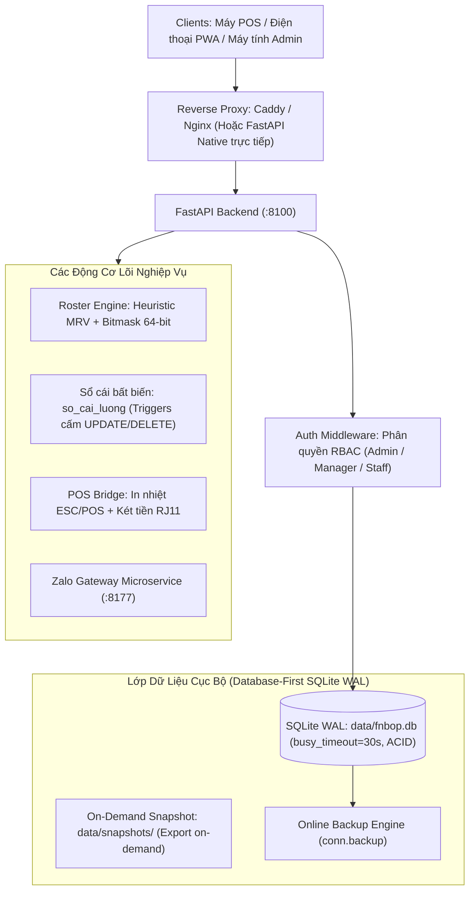
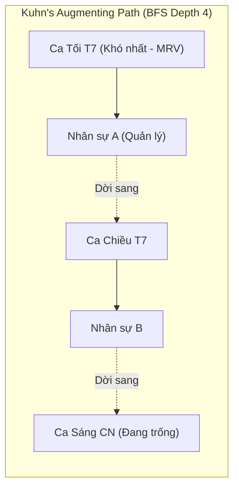

# HỒ SƠ KIẾN TRÚC HỆ THỐNG FNBOPS (SYSTEM ARCHITECTURE SPECIFICATION)

**Dự án:** `fnbop` - Open-Source F&B Workforce & Operations OS  
**Giấy phép:** GNU Affero General Public License v3.0 (AGPL-3.0)  
**Trạng thái:** Production — Standalone On-Premise & SaaS-Ready  

---

## 1. TỔNG QUAN KIẾN TRÚC & TẦM NHÌN HỆ THỐNG

`fnbop` là hệ điều hành mã nguồn mở chuyên biệt cho quản trị nhân sự, điều phối ca làm việc, đối soát két tiền POS và tính lương tự động trong ngành F&B (Chuỗi Cà phê, Nhà hàng, Quán bar, Trà sữa). Hệ thống được thiết kế theo triết lý **Edge-First & SaaS-Ready**, hỗ trợ đồng thời hai chế độ vận hành:

1. **Chế độ Standalone On-Premise (Hiện tại v1.0):** Chạy cục bộ trực tiếp trên máy POS thu ngân hoặc máy tính tại quán (macOS, Windows, Ubuntu). Vận hành đầy đủ ngay cả khi mất kết nối Internet thông qua SQLite WAL Mode và PWA Offline Cache.
2. **Chế độ Multi-Tenant Cloud SaaS (Roadmap v2.0):** Sẵn sàng mở rộng triển khai trên máy chủ đám mây phục vụ chuỗi nhiều chi nhánh, phân tách vật lý (Database-per-Tenant) và chống truy cập chéo.



---

## 2. MIỀN 1: KIẾN TRÚC CSDL — HIỆN TẠI (v1.0) & ĐỊNH HƯỚNG (Roadmap v2.0)

### 2.1. Hiện Trạng Sản Phẩm (v1.0 Production): Local-First Single Tenant (Edge POS Node)

Trong phiên bản hiện tại, hệ thống được chuẩn hóa theo mô hình **Database-First SQLite WAL (Edge POS Node)**:
- **Tập tin CSDL duy nhất:** `data/fnbop.db` (Single Source of Truth).
- **Chế độ ghi Write-Ahead Logging (WAL):** Kích hoạt `PRAGMA journal_mode = WAL`, `PRAGMA synchronous = NORMAL`, `busy_timeout = 30000ms`.
- **Chấm dứt ghi song song JSON (No Dual-Write):** Toàn bộ các thao tác chấm công, xếp ca, đổi PIN, kết ca, đánh giá, chi lương được lưu trực tiếp vào CSDL SQLite WAL. Các file JSON chỉ dùng làm Seed Data ban đầu và Snapshot On-Demand khi Admin yêu cầu xuất.
- **Đặc tính:** Vận hành 100% offline tại quầy POS, không phụ thuộc kết nối Internet bên ngoài, triệt tiêu hoàn toàn độ trễ mạng và loại trừ nguy cơ rò rỉ dữ liệu qua mạng.
- **Sao lưu an toàn:** Sử dụng SQLite Online Backup API (`sqlite3.Connection.backup`) kết hợp `GET /api/v1/cc/admin/export-json-snapshot` và script `scripts/export_sqlite_snapshot.py`.

---

### 2.2. Định Hướng Mở Rộng: Multi-Tenant Cloud SaaS (Roadmap v2.0)

Khi phát triển lên hệ thống đám mây phục vụ chuỗi nhượng quyền đa chi nhánh (Franchise SaaS), mô hình sẽ được nâng cấp thành **Database-per-Tenant** kết hợp **Central Control DB**:

| Tiêu chí | v1.0 Single-Tenant Edge (`data/fnbop.db`) | Roadmap v2.0 Multi-Tenant (`{tenant_id}.db` + `control.db`) |
|---|---|---|
| **Môi trường** | Máy POS tại cửa hàng / Server cục bộ | Đám mây tập trung đa chi nhánh (Multi-branch SaaS) |
| **Write Concurrency (WAL)** | 1 file CSDL cho 1 quán, tối đa hóa I/O NVMe tại quán | Mỗi quán 1 file riêng biệt, WAL lock độc lập không nghẽn chéo |
| **Bảo vệ IDOR** | Không có nguy cơ (cô lập 100% theo phần cứng quán) | Cô lập vật lý tuyệt đối theo file database |
| **Cấu trúc File** | `data/fnbop.db` | `data/control.db` (auth, tenants) + `data/tenants/{tenant_id}.db` |

### 2.2. Schema Bảng `store_configs` & Cơ Chế Versioning (Control DB)

Sử dụng chuẩn `STRICT` table (SQLite 3.37+) kết hợp ràng buộc kiểm tra JSON hợp lệ và cơ chế Versioning hỗ trợ Optimistic Locking:

```sql
PRAGMA journal_mode = WAL;
PRAGMA synchronous = NORMAL;
PRAGMA foreign_keys = ON;

CREATE TABLE store_configs (
    tenant_id TEXT PRIMARY KEY,
    config_json TEXT NOT NULL CHECK (json_valid(config_json)),
    version INTEGER NOT NULL DEFAULT 1,
    updated_at INTEGER NOT NULL DEFAULT (unixepoch())
) STRICT;

-- Trigger tự động tăng version và timestamp khi sửa cấu hình quán
CREATE TRIGGER trg_store_configs_update
AFTER UPDATE OF config_json ON store_configs
FOR EACH ROW
BEGIN
    UPDATE store_configs
    SET version = OLD.version + 1,
        updated_at = unixepoch()
    WHERE tenant_id = OLD.tenant_id;
END;
```

---

### 2.3. Cơ Chế Phòng Chống IDOR (Insecure Direct Object Reference)

IDOR là nguy cơ bảo mật số một đối với hệ thống Multi-Tenant. Kiến trúc áp dụng triệt để ba nguyên tắc phòng ngự:

1. **Zero-Trust Client Input:** Tuyệt đối không chấp nhận `tenant_id` từ URL path parameters (`/api/:tenant_id/roster`), Query parameters (`?tenant_id=xxx`), hoặc Request Body để xác định thẩm quyền truy xuất dữ liệu.
2. **Context-Bound Resolution:** `tenant_id` được giải mã và kiểm tra chữ ký bắt buộc từ **Verified JWT Token** tại tầng Auth Middleware, sau đó gán cố định vào Request Context (`contextvars` trong Python). Mọi hàm Data Access Layer (DAL) tự động lấy `tenant_id` từ Context này.
3. **Deep Clone Cache In-Memory Chống Cache Poisoning:** Khi đọc cấu hình từ Cache (LRU in-memory), DAL bắt buộc trả về một bản clone độc lập (`copy.deepcopy()` trong Python) hoặc Read-Only Frozen Object. Điều này loại bỏ hoàn toàn khả năng một luồng xử lý của tenant A sửa đổi object trong RAM gây nhiễm độc dữ liệu sang tenant B.

---

### 2.4. Quản Lý Kết Nối Qua LRU Connection Pool

Để giải quyết bài toán cạn kiệt File Descriptors (FD limit) khi hệ thống có hàng ngàn tenant:
- Backend không mở kết nối đến toàn bộ các file `.db` cùng lúc.
- Sử dụng **LRU Connection Pool** duy trì tối đa 100 - 200 kết nối SQLite đang hoạt động.
- Tự động đóng kết nối (`conn.close()`) đối với các tenant không phát sinh truy vấn sau 10 phút để giải phóng bộ nhớ RAM và File Descriptors cho hệ điều hành.

---

## 3. MIỀN 2: THUẬT TOÁN XẾP CA TỐI ƯU (ROSTER ENGINE)

### 3.1. Hạn Chế Của Thuật Toán Cũ (Greedy + 1-Step Backtracking Swap)
- Thuật toán tham lam (Greedy) kết hợp đảo 1 bước chỉ xử lý được xung đột hoán đổi trực tiếp giữa hai nhân sự ($A \leftrightarrow B$).
- Khi hệ thống có từ 20 đến 50 nhân sự và gặp xung đột dây chuyền từ 3 nhân sự trở lên (ví dụ: Nhân sự A cần đổi ca cho B, B đổi cho C, C mới trám được vào chỗ trống của A), thuật toán Greedy bị rơi vào bế tắc cục bộ (local minima), dẫn đến bỏ trống ca không thể phân bổ hoặc bùng nổ thời gian đệ quy.

---

### 3.2. Thuật Toán Cải Tiến: MRV + Kuhn's Augmenting Path (BFS-4) + 64-bit Bitmask



#### 1. Sắp Xếp Thứ Tự Bằng Heuristic MRV (Minimum Remaining Values)
- Không xếp tuần tự từ Thứ 2 đến Chủ Nhật.
- Tính toán "độ khó" (số ứng viên hợp lệ khả dụng) của từng slot ca. **Ưu tiên xếp các ca khó nhất trước** (ví dụ: Ca tối Thứ 7/Chủ Nhật, các slot cách ly 17h/18h). Các ca dễ có nhiều người đăng ký sẽ xếp sau. Chiến lược này giảm 80% nguy cơ rơi vào nhánh cụt ở cuối tuần.

#### 2. Thuật Toán Đường Tăng Luồng (Augmenting Path - Kuhn's Algorithm)
- Mô hình hóa mối quan hệ giữa Nhân viên và Slot ca thành đồ thị hai phía (Bipartite Graph).
- Khi gặp bế tắc, kích hoạt Breadth-First Search (BFS) với độ sâu tối đa 4 tầng (`max_depth = 4`) để tìm chuỗi dời ca dây chuyền:
  $$\text{Ứng viên mới} \rightarrow \text{Slot 1} \xrightarrow{\text{đẩy}} \text{A} \rightarrow \text{Slot 2} \xrightarrow{\text{đẩy}} \text{B} \rightarrow \text{Slot 3 (trống)}$$

#### 3. Bitmask 64-bit Kiểm Tra Xung Đột Ca Tức Thì
- Biểu diễn lịch làm việc trong ngày của nhân viên và các ràng buộc slot bằng số nguyên 64-bit (`uint64`).
- Kiểm tra xung đột slot 17h và 18h bằng một phép toán bitwise duy nhất trong 1 chu kỳ CPU:
  ```python
  # Kiểm tra xem nhân sự có bị trùng slot hoặc vi phạm quy tắc cách ly 17h/18h hay không
  if (employee_schedule_mask & shift_conflict_mask) == 0:
      # Hợp lệ, không có xung đột ca
      assign_shift()
  ```
- Đảm bảo thời gian tính toán toàn bộ lịch tuần cho 50 nhân sự hội tụ **dưới 50ms**.
- *Giao diện tích hợp mở rộng:* Hệ thống tương thích với bộ giải quy hoạch nguyên Google OR-Tools CP-SAT (~3500 biến nhị phân, giải quyết toàn bộ ràng buộc cứng và mềm trong 30ms - 120ms).

---

## 4. MIỀN 3: SỔ CÁI KẾ TOÁN BẤT BIẾN (APPEND-ONLY PAYROLL LEDGER)

### 4.1. Nguyên Tắc Thiết Kế Sổ Cái
Sổ cái kế toán tuân thủ nguyên tắc kế toán kép và bất biến tài chính: **Tuyệt đối không bao giờ dùng lệnh `UPDATE` hoặc `DELETE` trên bảng dữ liệu sổ cái**. Mọi sai lệch, điều chỉnh giờ làm, hủy thưởng phạt, hoặc xử lý ca đóng tự động (Auto-Close) bắt buộc phải ghi nhận bằng bút toán đảo (Reversal Entry) hoặc bút toán bù trừ (Adjustment Entry).

### 4.2. Tiền Tệ Số Nguyên (Integer VNĐ)
Toàn bộ giá trị tiền tệ được lưu trữ dưới dạng **`INTEGER` (VNĐ)**. Tuyệt đối không dùng `FLOAT` hay `REAL` để tránh lỗi sai số tích lũy của dấu phẩy động IEEE 754 trong các phép chia/cộng dồn lương.

---

### 4.3. SQLite DDL & Triggers Bảo Vệ Tính Bất Biến

Trong mã nguồn thực tế (v1.0), sổ cái được triển khai tại bảng `so_cai_luong` (và tương thích với tên gọi chuẩn hóa `payroll_ledger` ở roadmap v2.0):

```sql
PRAGMA journal_mode = WAL;
PRAGMA synchronous = NORMAL;
PRAGMA foreign_keys = ON;

-- 1. BẢNG SỔ CÁI BẤT BIẾN (so_cai_luong)
CREATE TABLE IF NOT EXISTS so_cai_luong (
    id INTEGER PRIMARY KEY AUTOINCREMENT,
    tenant_id TEXT NOT NULL DEFAULT 'default',
    nhan_vien_id TEXT NOT NULL,
    staff_name TEXT NOT NULL,
    cham_cong_id TEXT,
    loai_su_kien TEXT NOT NULL CHECK(loai_su_kien IN (
        'DIEU_CHINH_GIO', 'THUONG', 'PHAT', 'UNG_LUONG',
        'DOI_MUC_LUONG', 'HUY_UNG_LUONG', 'HUY_THUONG',
        'HUY_PHAT', 'DIEU_CHINH_GIAM', 'REVERSAL'
    )),
    so_gio_thay_doi REAL DEFAULT 0,
    so_tien_thay_doi INTEGER DEFAULT 0,
    muc_luong_ap_dung INTEGER DEFAULT 17000,
    ly_do TEXT NOT NULL,
    nguoi_tao TEXT NOT NULL,
    created_at TEXT DEFAULT (datetime('now', 'localtime')),
    FOREIGN KEY (tenant_id) REFERENCES tenants(id) ON DELETE CASCADE
);

CREATE INDEX IF NOT EXISTS idx_so_cai_staff ON so_cai_luong(tenant_id, staff_name);
CREATE INDEX IF NOT EXISTS idx_so_cai_cham_cong ON so_cai_luong(cham_cong_id);

-- 2. TRIGGERS CẤM UPDATE VÀ DELETE TUYỆT ĐỐI
CREATE TRIGGER IF NOT EXISTS trg_so_cai_luong_no_update
BEFORE UPDATE ON so_cai_luong
BEGIN
    SELECT RAISE(ABORT, 'Bang so_cai_luong la so cai bat bien, nghiem cam sua ban ghi!');
END;

CREATE TRIGGER IF NOT EXISTS trg_so_cai_luong_no_delete
BEFORE DELETE ON so_cai_luong
BEGIN
    SELECT RAISE(ABORT, 'Bang so_cai_luong la so cai bat bien, nghiem cam xoa ban ghi!');
END;

-- 3. VIEW TỔNG HỢP BẢNG LƯƠNG TỨC THỜI
CREATE VIEW v_employee_payroll_summary AS
SELECT 
    employee_id,
    payroll_period,
    SUM(CASE WHEN entry_type IN ('REGULAR_PAY', 'AUTO_CLOSE_PAY', 'OVERTIME_PAY') THEN amount ELSE 0 END) AS base_earnings,
    SUM(CASE WHEN entry_type = 'BONUS' THEN amount ELSE 0 END) AS total_bonus,
    SUM(CASE WHEN entry_type = 'PENALTY' THEN amount ELSE 0 END) AS total_penalty,
    SUM(CASE WHEN entry_type = 'ADVANCE' THEN amount ELSE 0 END) AS total_advance,
    SUM(CASE WHEN entry_type IN ('REVERSAL', 'ADJUSTMENT') THEN amount ELSE 0 END) AS net_adjustments,
    SUM(amount) AS net_payable
FROM payroll_ledger
GROUP BY employee_id, payroll_period;
```

---

### 4.4. Quy Chuẩn Idempotency Key & Xử Lý Nghiệp Vụ Ca Auto-Close

#### Quy Tắc Đặt Khóa Idempotency Key:
- Chốt ca tự động: `f"SHIFT:{shift_id}:AUTO_CLOSE"`
- Bút toán đảo: `f"REV:{original_entry_id}"`
- Phê duyệt ca chuẩn sau đối soát: `f"SHIFT:{shift_id}:VERIFIED_v1"`
- Thưởng/Phạt: `f"TICKET:{ticket_id}:APPLY"`
- Chống chạy trùng dữ liệu: `INSERT OR IGNORE INTO payroll_ledger ...`

#### Quy Trình 2 Giai Đoạn Xử Lý Ca Quên Check-out (Auto-Close):
1. **Giai đoạn 1 (23:59 đêm phát sinh):** Cronjob tự động đóng ca mở quá 180 phút, tạm tính công sàn 4 tiếng (mức lương 25.000đ/h) $\rightarrow$ Ghi bút toán `AUTO_CLOSE_PAY`, `amount = +100000`, `idempotency_key = "SHIFT:901:AUTO_CLOSE"`.
2. **Giai đoạn 2 (Hôm sau - Quản lý đối soát):** Quản lý đối soát camera xác nhận nhân viên làm thực tế 6 tiếng (lương đúng: 150.000đ). Hệ thống thực thi 1 Transaction nguyên tử gồm 2 bản ghi:
   - **Bản ghi 1 (Đảo bút toán cũ):** `entry_type = 'REVERSAL'`, `amount = -100000`, `reverses_entry_id = <ID_buoc_1>`, `idempotency_key = "REV:SHIFT:901:AUTO_CLOSE"`.
   - **Bản ghi 2 (Ghi nhận công chuẩn):** `entry_type = 'REGULAR_PAY'`, `amount = +150000`, `idempotency_key = "SHIFT:901:VERIFIED_v1"`.

---

## 5. MIỀN 4: RESTFUL API V1 & BẢO MẬT XÁC THỰC

### 5.1. Cây Endpoint RESTful v1 Chuẩn Mực

Toàn bộ hệ thống API được tách bạch thành các resource module độc lập trong `backend/routers/`:

```
/api/v1/
├── auth/
│   ├── POST   /login              # Đăng nhập bằng PIN / Username-Password
│   ├── POST   /refresh            # Làm mới Access Token (Sliding Session 7 ngày)
│   ├── POST   /logout             # Đăng xuất & hủy session
│   ├── POST   /change-pin         # Đổi mã PIN (tự động nâng token_version)
│   └── GET    /me                 # Thông tin nhân sự trong Request Context hiện tại
│
├── attendance/
│   ├── POST   /check-in           # Chấm công vào ca (WiFi SSID / BSSID / WAN IP)
│   ├── POST   /check-out          # Chấm công ra ca
│   ├── GET    /today              # Trạng thái ca làm việc hiện tại trong ngày
│   ├── GET    /history            # Lịch sử chấm công của nhân viên
│   └── POST   /approve-auto-close # Quản lý phê duyệt / điều chỉnh ca auto-close
│
├── roster/
│   ├── GET    /shifts             # Lấy danh sách ca làm việc trong tuần
│   ├── POST   /generate           # Chạy thuật toán xếp ca tối ưu (MRV + BFS)
│   ├── PUT    /assignments        # Điều chỉnh phân bổ ca thủ công
│   ├── GET    /conflicts          # Quét kiểm tra vi phạm ràng buộc ca (64-bit Bitmask)
│   └── POST   /publish            # Công bố lịch tuần chính thức cho nhân viên
│
├── payroll/
│   ├── GET    /summary            # Tổng hợp bảng lương theo kỳ (YYYY-MM)
│   ├── GET    /ledger             # Tra cứu chi tiết sổ cái Append-Only
│   ├── POST   /adjustments        # Thêm bút toán điều chỉnh / thưởng / phạt
│   └── POST   /disburse           # Đóng kỳ lương và xuất lệnh chi trả
│
├── pos/
│   ├── POST   /heartbeat          # POS Heartbeat Agent gửi nhịp tim định kỳ
│   ├── POST   /drawer/kick        # Kích hoạt mở ngăn kéo đựng tiền RJ11 qua ESC/POS
│   ├── POST   /closing            # Biên bản chốt két tiền mặt cuối ngày
│   └── POST   /sync-orders        # Đồng bộ hóa đơn từ POS365 / máy bán hàng
│
└── stores/
    ├── GET    /config             # Đọc cấu hình quán (store_configs)
    ├── PUT    /config             # Cập nhật cấu hình quán (Optimistic Lock Version)
    └── GET    /info               # Thông tin chi nhánh và danh sách nhân sự
```

#### Chiến Lược Chuyển Đổi Tương Thích Ngược (Backward-Compatible Aliasing):
Để các client PWA và POS Edge hiện hữu không bị gián đoạn:
- Module `backend/routers/fnb_ops.py` đăng ký toàn bộ các path `/api/v1/cc/*` cũ.
- Các endpoint này forward trực tiếp request sang router RESTful mới, đính kèm header `X-API-Deprecated: true` và ghi nhận telemetry để theo dõi lộ trình di chuyển của client.

---

### 5.2. Bảo Mật Xác Thực PIN 4 Số & Cơ Chế Thu Hồi Token Tức Thì

#### Progressive Lockout Bảo Vệ PIN 4 Số:
Mã PIN 4 số ($10^4 = 10.000$ tổ hợp) rất tiện dụng cho kiosk F&B nhưng đối mặt rủi ro Brute-Force. Hệ thống kiểm soát qua bảng `login_attempts`:
- 5 lần nhập sai liên tiếp $\rightarrow$ Khóa 5 phút.
- 10 lần nhập sai liên tiếp $\rightarrow$ Khóa 30 phút và gửi cảnh báo về Telegram Quản lý.

#### Cơ Chế `token_version` Thu Hồi JWT Tức Thì (Instant Revocation):
Không cần duy trì Redis Blacklist nặng nề, `fnbop` áp dụng giải pháp `token_version` siêu nhẹ trên SQLite:
1. Thêm cột `token_version INTEGER NOT NULL DEFAULT 1` vào bảng `staff_accounts`.
2. Khi sinh Access Token, nhúng claim `token_ver: account.token_version`.
3. Khi nhân viên đổi PIN, bị sa thải, hoặc thay đổi vai trò:
   ```sql
   UPDATE staff_accounts 
   SET token_version = token_version + 1 
   WHERE id = :employee_id;
   ```
4. FastAPI Auth Dependency so sánh `payload["token_ver"] < account.token_version`. Nếu nhỏ hơn, từ chối ngay lập tức với mã `HTTP 401 Unauthorized ("TOKEN_REVOKED")`. Toàn bộ token cũ trên các thiết bị lập tức bị vô hiệu hóa.

#### Chống Bypass IP Lockout Qua Reverse Proxy & VPN:
Hệ thống cấu hình danh sách **Trusted Proxies Whitelist** (`127.0.0.1`, subnet Docker bridge, dải mạng LAN nội bộ RFC 1918). Backend chỉ phân giải `X-Forwarded-For` hoặc `X-Real-IP` khi request xuất phát từ các proxy được ủy quyền.

---

## 6. MIỀN 5: KIẾN TRÚC STANDALONE POS & EDGE RESILIENCE

### 6.1. Vận Hành Ngoại Tuyến (Offline-First POS Architecture)
Trên máy POS thu ngân tại quán, hệ thống có thể hoạt động hoàn toàn độc lập khi mất kết nối Internet:
- **Frontend PWA:** Service Worker tự động cache toàn bộ static assets (HTML, JS, CSS, Font).
- **Backend POS:** FastAPI và SQLite WAL chạy cục bộ dưới dạng Windows Service (qua NSSM `FnBOpsPOS`) hoặc launchd daemon trên macOS.
- **Local mDNS Broadcaster:** Tự động phát sóng tên miền nội bộ `http://fnbops.local:8100` qua giao thức Zeroconf, cho phép nhân viên kết nối chấm công mà không cần nhớ địa chỉ IP máy POS.

### 6.2. Kiểm Thử Cô Lập Sandbox (Zero Data Pollution)
Mọi bài kiểm thử tự động trong `tests/conftest.py` chạy trên một môi trường SQLite tạm thời trong bộ nhớ RAM (`sqlite3.connect(":memory:")`) hoặc file sandbox trong `/tmp`. **Tuyệt đối không bao giờ làm biến đổi hay bẩn các file dữ liệu thật trong thư mục `data/`**.

---

## 7. BẢNG TỔNG HỢP QUYẾT ĐỊNH KIẾN TRÚC (ADR MATRIX)

| Mã Quyết Định | Vấn Đề Kỹ Thuật | Giải Pháp Đã Chọn | Lợi Ích Cốt Lõi |
|---|---|---|---|
| **ADR-001** | Tranh chấp khóa ghi SQLite WAL giờ cao điểm | Mô hình Database-per-Tenant (`{tenant_id}.db` + `control.db`) | Triệt tiêu lỗi `SQLITE_BUSY`, cách ly dữ liệu vật lý giữa các quán |
| **ADR-002** | Rủi ro rò rỉ dữ liệu chéo Multi-Tenant (IDOR) | Zero-Trust Client Input, gán `tenant_id` từ Verified JWT Context | Loại bỏ nguy cơ IDOR, ngăn chặn cache poisoning qua Deep Clone |
| **ADR-003** | Xung đột xếp ca dây chuyền cho 20-50 nhân sự | MRV Heuristic + Kuhn's Augmenting Path (BFS-4) + 64-bit Bitmask | Xếp ca không bế tắc, thời gian tính toán toàn tuần < 50ms |
| **ADR-004** | Sai lệch tài chính & ca quên checkout | Sổ cái Append-Only, tiền INTEGER VNĐ, Triggers cấm Update/Delete | Toàn vẹn kiểm toán, xử lý ca auto-close minh bạch bằng bút toán đảo |
| **ADR-005** | Monolith router cồng kềnh khó bảo trì | Tách router RESTful v1 chuẩn mực + Aliasing tương thích ngược | Kiến trúc module hóa sạch sẽ, an toàn nâng cấp không vỡ client |
| **ADR-006** | Thu hồi token JWT không cần Redis | Cơ chế `token_version` siêu nhẹ lưu trên SQLite | Vô hiệu hóa token tức thì khi đổi PIN hoặc đổi quyền trong 0ms |
| **ADR-007** | Đổi cấu hình ca giữa chu kỳ làm lệch lịch sử | Immutable Versioning (`valid_to`/`from`) + Copy-on-Write Snapshot | Bảo vệ tính toàn vẹn dữ liệu quá khứ, không recalculate sai lương |
| **ADR-008** | Deadlock xếp ca cho quán 2-3 người kiêm nhiệm | Skill-Coverage Bitmask + Soft Constraints Relaxation (Penalty Cost) | Luôn tìm ra lịch khả thi cho quán siêu nhỏ, triệt tiêu lỗi UNSAT |
| **ADR-009** | Tranh chấp ghi SQLite WAL khi 20 NV cùng dập thẻ | Single-Writer In-Memory Write Queue + `busy_timeout=30000ms` + `threading.RLock()` | 0% lỗi `database is locked` hay tự khóa Deadlock, latency dập thẻ < 100ms |
| **ADR-010** | Chấm công đúng người, đúng quán | Xác thực mạng nội bộ: Khớp IP WAN WiFi quán + Subnet LAN (v1.0); Mã QR động mở rộng (v2.0) | Vận hành đơn giản, không tốn chi phí mua máy chấm công vân tay rời |
| **ADR-011** | Lương âm & rủi ro nhân viên nghỉ quỵt nợ | Hạch toán Tài khoản Phải thu + Deduction Cap 30-50% + Offboarding Gate | Bảo vệ dòng tiền chủ quán, minh bạch báo cáo tài chính P&L |
| **ADR-012** | Mở rộng SaaS 1.000 quán F&B tự vận hành | Hybrid Edge SQLite WAL (Local <10ms) + Cloud PostgreSQL + CDC/CRDT Sync | Offline-first tại điểm bán, tập trung trên Cloud, zero-downtime migration |

---

## 8. QUY TẮC VẬN HÀNH QUY MÔ LINH HOẠT & HẠCH TOÁN CÔNG NỢ

### 8.1. Tương Thích Từ Quán Nhỏ (2-5 Nhân Sự) Đến Chuỗi Lớn (20+ Nhân Sự/Ca)
1. **Quán Siêu Nhỏ (2 - 5 nhân sự):** Sử dụng **Skill-Coverage Bitmask** (`RequiredMask` vs `SkillMask`) và nới lỏng ràng buộc mềm (anti-clopening, giới tính) khi thiếu nhân sự để không bao giờ bị deadlock xếp ca.
2. **Quán Lớn / Chuỗi (10 - 20+ NV dập thẻ đồng thời):** Áp dụng SQLite WAL với `busy_timeout = 30000ms`, `synchronous = NORMAL` đảm bảo không khóa ghi chéo và phản hồi dưới 100ms.

### 8.2. Tiêu Chuẩn Kế Toán Sổ Cái Bất Biến & Xử Lý Nợ
- Bảng lương tháng được tổng hợp từ các bút toán của bảng `so_cai_luong` kết hợp giờ công thực tế đã duyệt.
- Khoản chênh lệch âm (ứng tiền/phạt > lương) được áp trần khấu trừ tối đa 50% lương gộp hàng tháng (`deduction_cap`), phần nợ vượt trần chuyển sang công nợ kỳ sau (`uncollected_debt`) và kiểm soát qua cổng quyết toán thôi việc (`Offboarding Gate`).

---

*Tài liệu triển khai và cấu hình phần cứng POS xem tại [`docs/DEPLOYMENT.md`](DEPLOYMENT.md).*

